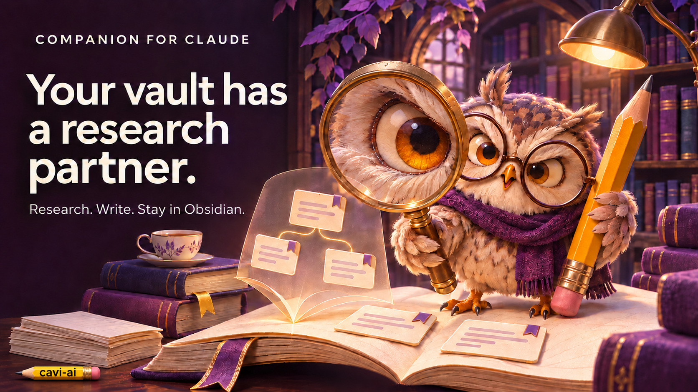
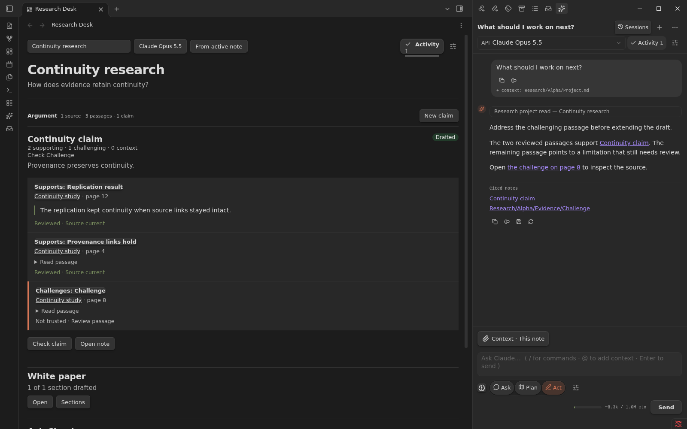
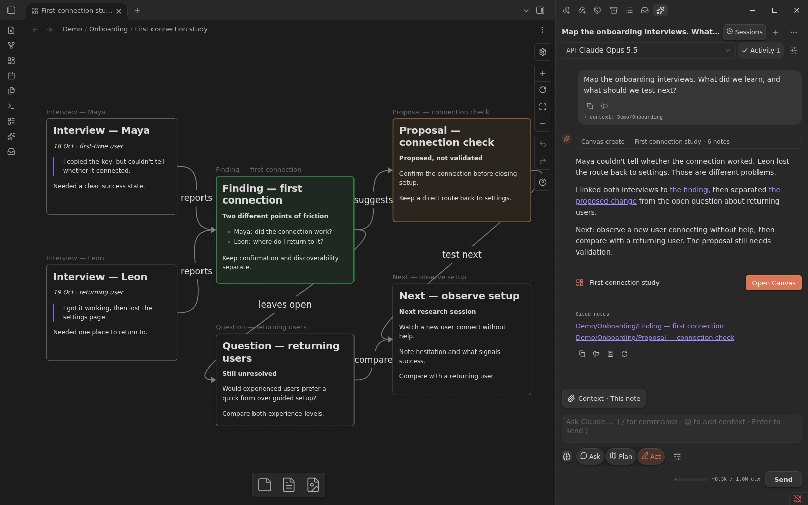

# Companion for Claude

Bring your notes, sources and AI into the same workspace.



[](https://github.com/cavi-ai/claude-obsidian/actions/workflows/obsidian-plugin-ci.yml)
[](LICENSE)

Companion helps you research, write and create inside [Obsidian](https://obsidian.md).
Find relevant notes and PDF passages, develop a source-linked argument, turn it
into a draft or interactive artifact, and review edits before they change your notes.

[**Install Companion for Claude**](https://obsidian.md/plugins?id=claude-companion)
· [Quick start](#quick-start)
· [Read the guides](#guides)

Install the plugin from the store link above. To build or contribute, start
with [CONTRIBUTING.md](CONTRIBUTING.md) and the [plugin source](obsidian-plugin/).
The public release repository is
[companion-for-claude](https://github.com/cavi-ai/companion-for-claude).

## Quick start

1. In Obsidian, open **Settings → Community plugins → Browse**, search for
   **Companion for Claude**, then install and enable it.
2. Open Companion and choose a signed-in Claude Code, Codex, or OpenCode CLI on
   desktop, an Anthropic API key on any device, or a local model.
3. Open a project note, turn on the **Note** context chip and choose **Act**.
   Start with a question worth answering:

   > Find the notes and PDF passages that support or challenge this idea.
   > Give me a source-linked outline before drafting.

[Try a reviewed note edit →](obsidian-plugin/README.md#try-one-note-edit-you-control) ·
[Full setup guide →](guides/getting-started.md)

## Put your notes to work

Work develops across many notes and many sessions. Companion keeps your sources,
drafts and decisions together in the vault where you already think.

### Find the passage you remember

Combine keyword and on-device semantic search to find relevant notes and PDF
passages, even when you do not remember the exact words. Bring the active note,
selections, links, folders and images into the conversation. Agent mode can
search, read and follow links, with every tool step visible.

[Explore context and agent mode →](guides/agent-mode.md)

### Keep the argument connected to its sources

Research Desk brings sources, passages, claims, outlines and drafts into one
project. See what supports a claim, what challenges it and which section needs
work. Review the evidence and preview a draft before accepting it. Research
records remain ordinary Markdown notes in your vault.

<p align="center">
  
</p>

[See the research workflow →](guides/research-workbench.md)

### Make something from what you find

Turn your research into a draft, an interactive HTML artifact, a native Canvas
or an Obsidian Base. Notes, artifacts and project records stay alongside the
material that informed them.



[Explore interactive artifacts →](guides/artifacts.md)

### Keep the final word

Review proposed note edits and accept or reject individual changes before
applying them. Other write tools ask for confirmation unless you grant access
for the session. Conversations persist across restarts; an interrupted turn
returns as stopped work with a **Retry** action.

[Learn about edits and guardrails →](guides/agent-mode.md#editing-notes-diffs-not-writes)

## Choose your connection

- **CLI sign-in** — desktop chat through an installed, signed-in Claude Code,
  Codex, or OpenCode command. Each CLI keeps its own credentials.
- **Anthropic API** — direct streaming chat on desktop and mobile with your API
  key, long-term OAuth token, or environment credential.
- **Local models** — Ollama or an OpenAI-compatible endpoint for chat and
  utility work. Tool-capable Ollama models can run the vault agent locally.
- **On-device GPU chat** — a downloaded model runs inside Obsidian on supported
  hardware. See the [local model guide](guides/local-models.md) for setup and
  backend capabilities.
- **Auto** — start with Claude and fall back to a reachable local model when
  Claude is offline, rate-limited, or unavailable.

[Authentication and cost →](guides/auth.md) ·
[Local models and on-device search →](guides/local-models.md)

## Built for control

- **Reviewable by default.** Agent writes require confirmation; diff-based edits
  require explicit hunk acceptance.
- **Local-first where it matters.** Semantic embeddings run on device. The
  optional MCP bridge binds to `127.0.0.1`, requires a bearer token, and keeps
  writes disabled until you enable them.
- **Your vault remains yours.** Research records, artifacts, Canvas files,
  Bases, and generated notes are ordinary vault files. Conversations persist
  across restarts without becoming a separate knowledge store.
- **Extensible without being tangled.** Companion can expose live-vault tools
  through its optional MCP bridge and consume explicitly configured external
  MCP servers from agent mode.

[Privacy and data flow →](obsidian-plugin/README.md#what-leaves-your-machine) ·
[MCP bridge security and setup →](guides/claude-code-bridge.md)

## Companion and portable workflows

This repository contains two related products with separate jobs:

- [`obsidian-plugin/`](obsidian-plugin/) is **Companion for Claude**, the
  Obsidian community plugin described on this page.
- [`claude-plugin/`](https://github.com/cavi-ai/obsidian-agent) is the pinned
  **obsidian-agent** project: portable workflows for Claude, Codex, Gemini,
  OpenCode, and AgentSkills hosts using the official Obsidian CLI. It does not
  require Companion or MCP.

[Explore portable workflows and supported hosts →](https://github.com/cavi-ai/obsidian-agent)

## Guides

- [Getting started](guides/getting-started.md)
- [Agent mode, edits, and guardrails](guides/agent-mode.md)
- [Research Desk](guides/research-workbench.md)
- [Interactive artifacts](guides/artifacts.md)
- [Local models and semantic search](guides/local-models.md)
- [Claude Code and the MCP bridge](guides/claude-code-bridge.md)
- [Authentication and cost](guides/auth.md)
- [Architecture](guides/architecture.md)
- [FAQ](guides/faq.md)

<details>
<summary><strong>Build from source</strong></summary>

```bash
git clone --recurse-submodules https://github.com/cavi-ai/claude-obsidian.git
```

Already cloned without submodules:

```bash
git submodule update --init --recursive
```

See [`obsidian-plugin/README.md`](obsidian-plugin/README.md#development-and-testing)
for development and test commands.

</details>

## Open source

[Contributing](CONTRIBUTING.md) · [Security](SECURITY.md) ·
[Code of conduct](CODE_OF_CONDUCT.md) · [Attribution](NOTICE) · [MIT license](LICENSE)

The interface aesthetic is an original reformulation inspired by Thariq
Shihipar's [“unreasonable effectiveness of HTML”](https://github.com/ThariqS/html-effectiveness)
gallery. Steph Ango's [Obsidian Skills](https://github.com/kepano/obsidian-skills)
serve as format references for Obsidian-native output. Both upstream projects
are pinned, unmodified submodules with full attribution in [`NOTICE`](NOTICE).
